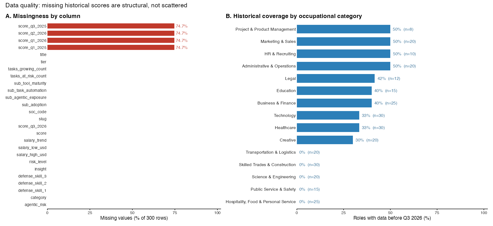

# Data Quality Assessment — AI Career Threat Index

**Step 2 deliverable.** Dataset: `ai-career-threat-index` v2026.3 (MeritForge AI),
https://github.com/Jott2121/ai-career-threat-index, MIT licence. Raw files are kept
untouched in `data/raw/`; nothing in this step is cleaned, imputed or deleted.
Code: `src/data_quality.R` (R 4.6; packages in `requirements.R`).
Tables: `outputs/tables/dq_*.csv`. Figure: `outputs/figures/dq_missingness_overview.png`.

```bash
Rscript requirements.R        # install readr, dplyr, jsonlite, ggplot2, patchwork
Rscript src/data_quality.R    # regenerate every table and the figure from data/raw/
```

## 1. Dataset dimensions

| File | Shape | Notes |
|---|---|---|
| `ai-career-threat-index.csv` | 300 rows x 26 columns | One row per occupation; the analysis file |
| `ai-career-threat-index.json` | 300 role records, 21 keys each + metadata | Same data plus task lists, rationales, salary anchors |
| `soc-crosswalk.csv` | 867 rows x 7 columns | Every BLS SOC 2018 code mapped to a scored role |

The CSV holds 7,800 cells across 11 text fields (identifiers, category, published bands,
salary trend, three defence skills, free-text insight) and 15 numeric fields (score,
four sub-scores, five quarterly scores, two salary bounds, two task counts, tier).
It covers 15 occupational categories (8 to 30 roles each) and 5 quarterly score
snapshots (Q1 2025 - Q3 2026).

## 2. Missing-value findings

**896 of 7,800 cells are missing (11.5%), and every one of them sits in the four
historical score columns.** The other 22 columns are complete.

| Column | Missing | % | Diagnosis |
|---|---|---|---|
| `score_q1_2025` | 224 | 74.7% | Structural |
| `score_q3_2025` | 224 | 74.7% | Structural (identical pattern) |
| `score_q1_2026` | 224 | 74.7% | Structural (identical pattern) |
| `score_q2_2026` | 224 | 74.7% | Structural (identical pattern) |
| `score_q3_2026` | 0 | 0% | Complete — current score |
| all other columns | 0 | 0% | Complete |

**The missingness is not random and can be fully explained.** The v2026.3 changelog
states that 224 new roles entered the index this quarter and "begin their history at
Q3 2026 — earlier quarters are never backfilled". The data confirm this exactly:

- **Tier predicts one side perfectly.** All 159 tier-2 roles lack history, so tier 2 is
  a sufficient condition for the gap; within tier 1 the split is 65 of 141 missing, because
  tier 1 mixes original roles with newly added ones.
- **Category composition drives the pattern.** Five categories have no history
  whatsoever (Hospitality/Food/Personal Service 25, Skilled Trades & Construction 30,
  Transportation & Logistics 20, Science & Engineering 20, Public Service & Safety 15 =
  110 roles). The other ten categories are 30-50% covered (see figure, panel B).
- **No residual gaps inside the panel.** For the 76 roles that do have history, all
  4 x 76 later quarter values are present: the historical panel is rectangular.
- The companion crosswalk has 33 unmatched SOC codes (all farm `45-xxxx` and military
  `55-xxxx`) with blank match, score and band — out of scope, not corrupt.



*Figure 1. (A) Missing values by column: only the four pre-2026 history columns are
affected, each at a flat 74.7%. (B) Coverage is not spread evenly across the 15
categories - five are 0% covered, the rest 30-50% - which is what makes the gap
structural rather than sporadic.*

Because missingness is deterministic given tier and role entry date rather than random, listwise deletion
of the four history columns would remove 75% of roles and all of five categories. It is
therefore a **design feature to be modelled explicitly** (a 300-role 2026 cross-section
plus a 76-role balanced 5-quarter panel), not a defect to repair.

## 3. Encoding and consistency findings

18 checks, 14 passed outright and 4 flagged as legitimate/structural (no failures):

- **Duplicates:** 0 duplicate rows, 0 duplicate slugs, 0 duplicate titles.
- **Whitespace/casing:** all 11 text fields free of leading/trailing whitespace; no
  padded or mixed-case category spellings. The 15 category labels (`&` and `HR`
  acronym included) are byte-identical to the JSON metadata list.
- **Sentinel tokens:** no `NA`, `null`, `-1`, `?` or similar placeholders; missing values
  are genuine blanks only.
- **Label domains:** `category` 15 levels, `risk_level` 4, `salary_trend` 4,
  `agentic_risk` 4, `tier` 2 — all consistently cased, no stray levels.
- **Identifiers:** 300/300 SOC codes match `NN-NNNN`, 300/300 slugs are clean, and every
  scored SOC code appears in the crosswalk.
- **Shared SOC codes (legitimate):** 29 BLS codes cover 81 role rows (e.g. `13-1071` ->
  Recruiter, HR Generalist, Talent Sourcer, Executive Recruiter, HRIS Analyst). These are
  genuinely distinct job titles, not duplicated records.
- **CSV vs JSON agreement:** row order, all 300 scores, all salary bounds, all task-list
  lengths and all 604 observed quarterly values match exactly. No version drift.
- **`risk_level` is not a deterministic function of `score`:** 14 of 300 roles carry a band
  one step away from the band implied by their score. 11 of the 14 sit within 5 points of
  a published boundary (the metadata's explicit band-stability rule), and 4 of the 14 are
  roles that also carry a documented restatement reason. This is a labelling convention, not a coding error,
  but it means band and score should not be used interchangeably.
- **`agentic_risk` adds no information:** it is an exact band of `sub_agentic_exposure`
  (0 mismatches over 300 roles).
- **7 insights contain non-ASCII characters** (curly quotes, em dashes) — correct UTF-8
  typography, not mojibake.

## 4. Numeric validation findings

13 checks: 10 passed, 3 classified as legitimate extremes or structural.

| Check | Result |
|---|---|
| Data types | All scores, salaries, counts, sub-scores and quarters are integers (0 non-integer values) |
| `salary_low_usd < salary_high_usd` | 300/300; no equal or inverted bounds |
| Salary range | $24,000 - $500,000; 0 negative values anywhere |
| `score` in 0-100 | Yes, observed 4-92 |
| Sub-scores in 0-100 | Yes, all four, all 300 roles |
| Quarterly scores in 0-100 | Yes, 604/604 observed values |
| `score` vs `score_q3_2026` | Identical in 300/300 rows (perfect redundancy) |
| Composite reproducible | Published formula reproduces `score` 300/300, max \|diff\| 0.50 (rounding) |
| Task counts vs JSON task lists | Match 300/300 (`tasks_at_risk` 3-5, `tasks_growing` 2-4) |
| Salary spread | Median 73% of the lower bound; 9 roles exceed 150% |
| Crosswalk unmatched rows | 33/867, structural |

**Outliers (IQR, 1.5 x IQR fences) — flagged, retained, and individually verified:**

| Column | Fence (upper) | Flagged | Examples | Verdict |
|---|---|---|---|---|
| `salary_low_usd` | 115,000 | 16 (5.3%) | Radiologist 300k, Surgeon 280k, Psychiatrist 220k | Legitimate: genuinely high-paying professions |
| `salary_high_usd` | 223,000 | 9 (3.0%) | Radiologist 500k, Surgeon 450k, Physician 400k | Legitimate |
| `score` | 87.5 | 1 (0.3%) | Data Entry Clerk 92 | Legitimate: top of the documented 0-100 scale |

No outlier is a data-entry error: each value is internally consistent with its role's
salary anchor and sub-scores. Salary is right-skewed (median midpoint $72,000 against a
mean of $83,038), so Step 3/EDA should use log or rank-based methods rather than trimming.

Two structural redundancies are worth carrying forward (they are properties of the index,
not defects): **`score` is a deterministic function of the four
sub-scores** (the published formula reproduces it up to rounding for every row), and the
sub-scores correlate with `score` at Spearman rho 0.90-0.99. Sub-scores are components of
the index, so they must not be presented later as independent predictors of it.

## 5. Overall data quality assessment

**No confirmed errors were found.** Every record is unique, correctly typed, inside its
documented range, internally consistent across the CSV, JSON and crosswalk, and reproducible
from the published formula. The quality issues that do exist are issues of design rather than
of dirt: (i) 75% of roles have no pre-Q3-2026 history, which is documented and fully explained
by tier and role entry date; (ii) three variables are redundant (`score`/`score_q3_2026`,
`score`/sub-scores, `agentic_risk`/`sub_agentic_exposure`); (iii) `risk_level` is a curated
band rather than a strict function of `score`. The dataset is fit for the planned analysis
provided the time-series work is restricted to the balanced 76-role panel and the estimated
nature of the scores is stated throughout — they are rubric-based editorial estimates, not
observed job losses.

## 6. Recommended cleaning actions (for Step 3)

| Issue | Columns | Records | Classification | Recommended action |
|---|---|---|---|---|
| Quarterly scores missing before Q3 2026 | `score_q1_2025` - `score_q2_2026` | 224 | Structural (by design) | Do not impute. Restrict time-series work to the 76-role panel; analyse the 300-role cross-section separately |
| Current score duplicates Q3 2026 score | `score`, `score_q3_2026` | 300 | Redundant | Keep one score column; build a long-format quarter variable from the history columns |
| Score is a deterministic function of the sub-scores (up to rounding) | `sub_*` | 300 | Redundant | Describe sub-scores as components; do not treat them as independent predictors |
| `risk_level` disagrees with the score band | `score`, `risk_level` | 14 | Documented boundary rule | Use score-derived bands for comparisons; keep the published label for reference |
| `agentic_risk` is a band of its sub-score | `agentic_risk`, `sub_agentic_exposure` | 300 | Redundant | Use the numeric sub-score; drop the band |
| Salary beyond IQR fences | `salary_low_usd`, `salary_high_usd` | 25 | Legitimate extremes | Retain; use log scale or Spearman |
| Score beyond IQR fence | `score` | 1 | Legitimate extreme | Retain (Data Entry Clerk, 92) |
| Unmatched crosswalk codes | crosswalk score/band fields | 33 | Structural, out of scope | Exclude from merges or label as unmatched; never assign a score |
| Duplicates, types, ranges, labels, sentinels | all | 0 | Passed | Only type conversions needed in Step 3 |

**Deliberately not done at this stage:** no rows dropped, no values imputed, no outliers
removed, no raw file edited.
